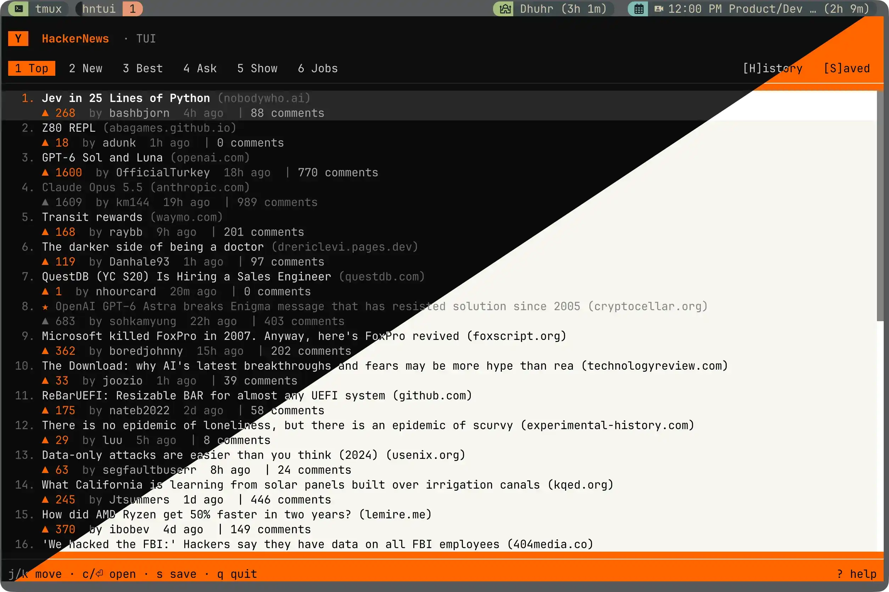

<h1 align="center">hntui: Hacker News in your terminal!</h1>

<p align="center">A sleek and elegant tui for browsing one of the best tech news sources.</p>

<p align="center">
  
</p>

```
curl -fsSL https://raw.githubusercontent.com/ahmd-sh/hntui/main/install.sh | sh
hntui
```

## What it does

- Browse all six HN feeds: Top, New, Best, Ask, Show, and Jobs.
- Navigate through a post's comments.
- Save posts for later.
- Vim + mouse support.
- Themes.
- ... and a really cool Knight Rider scanner animation for loaders (⁠◕⁠ᴗ⁠◕⁠ )

## Requirements

Any modern terminal with truecolor and UTF-8 will work. I've tested it in Ghostty on MacOS.

hntui is a single native binary with no dependencies: no runtime to install, whichever way you install it.

## Install

### Standalone binary (recommended)

```bash
curl -fsSL https://raw.githubusercontent.com/ahmd-sh/hntui/main/install.sh | sh
```

Installs the binary to `~/.local/bin`. You can also grab a binary for your platform directly from the [releases page](https://github.com/ahmd-sh/hntui/releases). Binaries cover macOS (Apple Silicon and Intel) and Linux (x64, arm64; static, so any distro).

To install a specific version, set `HNTUI_VERSION`:

```bash
curl -fsSL https://raw.githubusercontent.com/ahmd-sh/hntui/main/install.sh | HNTUI_VERSION=0.6.0 sh
```

### With npm or Bun

```bash
npm install -g @ahmd-sh/hntui
# or
bun add -g @ahmd-sh/hntui
```

Or run it once without installing:

```bash
npx @ahmd-sh/hntui
```

The package pulls in only the binary for your platform.

## Run

```bash
hntui
```

Press `q` (or `Ctrl-C`) to quit.

## Updating

```bash
hntui update
```

Checks the latest release and, for binary installs, replaces itself in place (after checking the new binary runs on your machine). If anything goes wrong, nothing is changed, and hntui explains what happened and what to try next. npm and Bun installs update through their package manager instead (`hntui update` will tell you the command). When a newer release exists, the status bar shows a quiet hint. `hntui --version` prints the installed version.

## Keybindings

hntui speaks vim: `j`/`k` to move, `gg`/`G` to jump, `Ctrl-D`/`Ctrl-U` to scroll, `J`/`K` to hop between top-level comment threads, `c` to fold the thread you're reading, `Esc`/`h` to go back. Press `?` in any view for the full list of shortcuts on that page.

### Mouse

Most things you can do with the keyboard, you can do with a mouse too.

- Click a tab to switch feeds.
- Click the `Y` tile to refresh the current feed (or to exit a story back to its list).
- Click any story row to select it. Click it again to open the comments.
- Right-click a story to open a context menu with Save, Open URL, Open Comments, and Copy Link.
- Click a comment's header line to collapse or expand its subtree.
- Double-click a comment's body to open its links popup.
- Click the story URL in the detail header to open it in your browser.
- Click outside a popup or context menu to dismiss it.
- Use your scroll wheel to scroll lists and comment trees, or drag the scrollbar.

Prefer the keyboard? Set `mouse = false` (see [Configuration](#configuration)) and your terminal keeps the mouse to itself.

### Selecting and copying text

Press `Y` to copy what's in focus: the story's link in a list, the selected comment's text in a thread, or the selected link in the links popup.

For anything else, select it in your terminal. While hntui has the mouse, hold a modifier as you drag: `Shift` in most terminals (Ghostty, WezTerm, Kitty, Alacritty, GNOME Terminal), `Option` in iTerm2.

With `mouse = false`, a plain drag selects.

## Configuration

Settings live in `~/.config/hntui/config.toml`. `hntui config` to show where it is and what's in effect (the first time, it creates the file with every setting commented); `hntui config edit` to open it in your `$EDITOR`.

```toml
# Theme at startup: "last" (whatever `t` left it on), "dark" or "light".
theme = "last"

# Mouse support: clicks, the scroll wheel, the right-click menu. Set it to
# false to leave the mouse to your terminal, so click-and-drag selects text.
mouse = true
```

Flags override the file for a single run: `hntui --theme light`, `hntui --no-mouse` (or `--mouse`). A setting hntui doesn't understand is reported in the status bar, and the rest still apply.

## Themes

Press `t` to toggle. The dark theme is mostly black with orange accents. The light theme is faithful to news.ycombinator.com: white background, orange topbar, the familiar beige row highlight, and HN's classic grey byline text. hntui starts in whichever theme you left it on, unless `theme` in the config says otherwise.

## Saved posts

Press `s` on any story to save it. Saved posts get a small star next to the title and show up in the Saved tab on the right side of the tab strip. The list persists across sessions in `~/.config/hntui/saved.json` as a small JSON file. (Config from the app's `hackernuis` days is migrated automatically on first run.) Press `s` again to remove a post from the list.

`S` jumps straight to the Saved list from anywhere.

## Development

```bash
git clone https://github.com/ahmd-sh/hntui.git
cd hntui
cargo run --release
```

`HN_DEMO=1 cargo run --release` adds a synthetic comment to the first story you open, with one link of each kind (an HN story, an HN comment, a dead HN link, an external site) for trying out link handling.

Data comes from the public [Hacker News Firebase API](https://github.com/HackerNews/API).

## Releases

Pushing a `v*` tag triggers two workflows:

- `.github/workflows/release.yml` builds the binaries (macOS arm64 and x64, static Linux arm64 and x64), smoke-tests them, and attaches the tarballs to a GitHub release. This is what `install.sh` and `hntui update` download.
- `.github/workflows/publish.yml` runs once the release is up: it repackages those binaries for npm (`@ahmd-sh/hntui` plus one `@ahmd-sh/hntui-<os>-<arch>` package per platform) and publishes them via OIDC trusted publishing, with a [SLSA provenance attestation](https://slsa.dev/) linking each tarball back to the exact commit and workflow run that produced it. Versions already on npm are skipped.

To release a new version, bump `version` in `Cargo.toml`, then:

```bash
cargo build                       # refreshes Cargo.lock
git commit -am "0.6.1" && git tag -a v0.6.1 -m 0.6.1
git push --follow-tags            # pushes annotated tags only, hence -a
```

## Acknowledgments

- [OpenTUI](https://github.com/anomalyco/opentui) by Anomaly. hntui was first built on it, and its look is the one this version reproduces, cell for cell.
- [opentui-spinner](https://github.com/msmps/opentui-spinner) by Matt Simpson. The Knight Rider loading scanner is adapted from `examples/knight-rider/utils.ts` (MIT).
- [ratatui](https://ratatui.rs) for the terminal output, and [Effect](https://effect.website), which powered the data layer of the TypeScript version.
- [Hacker News](https://news.ycombinator.com) for the content and the open API.

## License

[MIT](./LICENSE), Copyright (c) 2026 Ahmed Shaikh.
